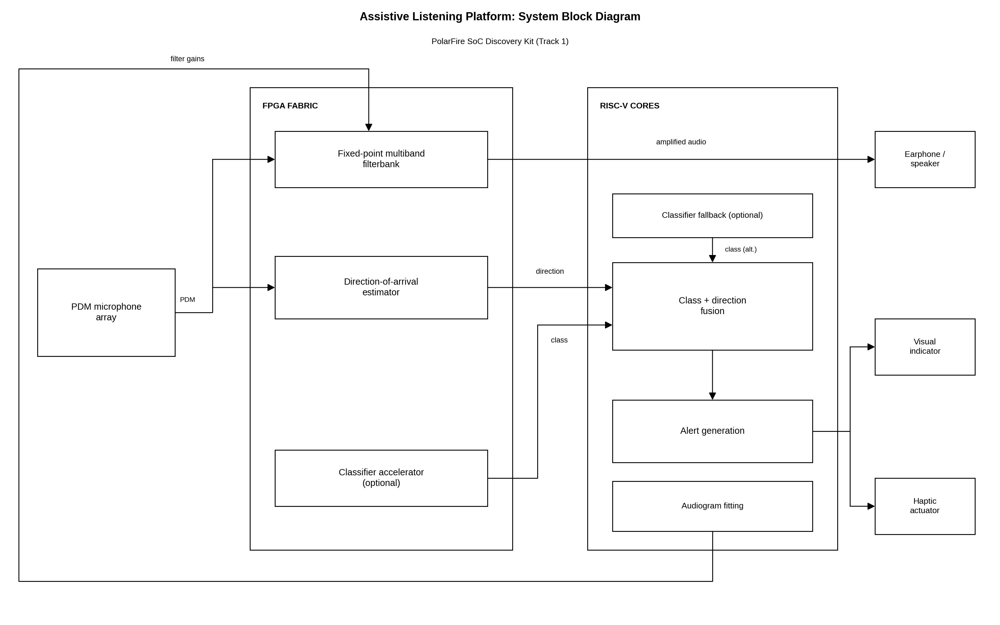

# Unmute: System Block Diagram

**Contest:** PolarFire FPGA Design Contest 2026, Track 1 (PolarFire SoC Discovery Kit)
**Team:** Hello KiTY

## Overview

Unmute is a hearing-assistance design for people with hearing loss. It splits the work across the two halves of the PolarFire SoC. The FPGA fabric handles the time-critical audio path, so amplification latency is set by hardware rather than by the operating system. The RISC-V cores handle the decisions: recognizing safety-critical sounds, combining sound type with direction, raising alerts, and fitting the device to the user's hearing.

## How to Read the Diagram

The diagram flows left to right. The microphone array is on the left, the processing is in the middle, and the outputs are on the right. The two grey-bordered regions show where each block runs: the **FPGA fabric** (left region) and the **RISC-V cores** (right region).

Arrows show the direction of signal flow. Lines without arrowheads are bus connections that split a signal to more than one block. Blocks marked **(optional)** are part of the classifier placement comparison, not the base design.

## Blocks

**PDM microphone array.** Digital microphones that produce a pulse-density-modulated bitstream. The same array feeds both the amplification path and the direction-of-arrival estimator.

**Fixed-point multiband filterbank (FPGA).** Splits the audio into frequency bands and amplifies each one by its gain. Its output goes directly to the earphone or speaker, so this is the main audio path. Its gains are set by audiogram fitting.

**Direction-of-arrival estimator (FPGA).** Estimates where a sound is coming from, using timing and level differences between microphones. It runs in parallel with the filterbank.

**Classifier accelerator (FPGA, optional).** A hardware version of the sound classifier that recognizes sirens, horns, and shouts.

**Classifier fallback (RISC-V, optional).** The same classifier running in software on the RISC-V cores. Comparing it with the accelerator shows which placement is faster and more efficient.

**Class and direction fusion (RISC-V).** Combines the sound class from the classifier with the direction from the estimator into one event.

**Alert generation (RISC-V).** Turns each event into a visual indicator and a haptic alert, so users who cannot rely on hearing still know what is happening and from where.

**Audiogram fitting (RISC-V).** Converts the user's audiogram into gain settings. The "filter gains" control path sends these settings back to the filterbank. It runs around the outside of the diagram to avoid crossing the signal lines.

**Outputs.** The earphone or speaker receives amplified audio. The visual indicator and haptic actuator receive alerts.

## Design Intent

The hardware path is deterministic, so amplification does not depend on software scheduling. The classifier placement is left open on purpose, so the project can measure which placement suits the device. The fitting and alert logic live in software, so they can be updated without changing the hardware.
